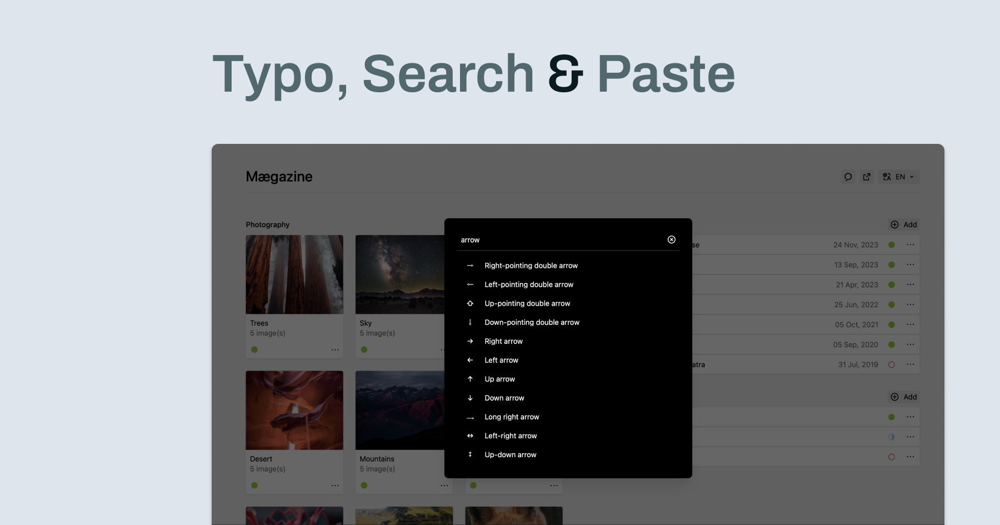

# Typo, Search & Paste


A Kirby plugin that provides a searchable interface for special characters, built on top of [Typo & Paste](https://github.com/philippoehrlein/typo-and-paste).



## Features

- Searchable database of special characters
- Multi-language support
- SQLite-based search engine
- Optional integration with Typo & Paste 3.x
- Standalone functionality in the Kirby 6 Panel

## Compatibility

Typo, Search & Paste 2.x requires Kirby 6 and PHP 8.3 or newer. For Kirby 4 and 5, use [Typo, Search & Paste 1.x](https://github.com/philippoehrlein/typo-search-and-paste/tree/support/kirby4-5).

## Installation

### Installation via Composer

```bash
composer require philippoehrlein/typo-search-and-paste:^2.0
```

For Kirby 4 and 5, run `composer require philippoehrlein/typo-search-and-paste:^1.0`.

### Manual Installation

1. Download and extract the plugin
2. Copy the `typo-search-and-paste` folder into `/site/plugins/`

## Configuration
### With Typo & Paste 3.x

If you have [Typo & Paste 3.x](https://github.com/philippoehrlein/typo-and-paste) installed, the search functionality is integrated automatically.

### Panel Toolbar Button

You can add the Typo, Search & Paste button to your Panel toolbar in two ways:

#### 1. In your blueprint:

```yaml
buttons:
  - typo-search-and-paste
  - preview
  - settings
  - languages
  - status
```

#### 2. Globally in your config:

```php
// site/config/config.php
return [
  'panel' => [
    'viewButtons' => [
      // Page view
      'page' => ['typo-search-and-paste', 'preview', 'settings', 'languages', 'status'],
      // Site view
      'site' => ['typo-search-and-paste', 'preview', 'languages']
    ]
  ]
];
```

## Troubleshooting

If you encounter FTS5-related errors on shared hosting environments, see [FTS5_TROUBLESHOOTING.md](FTS5_TROUBLESHOOTING.md) for solutions and configuration options.

## Contributing to the Character Database

The plugin uses  SQLite databases for efficient character searching. You can contribute to the character database by following these steps:

1. Navigate to the `data/src` directory
2. Create or modify JSON files for your language (e.g., `en.json`, `de.json`)
3. Each JSON file should follow this structure:

```json
{
  "characters": [
    {
      "value": "©",
      "name": "Copyright Sign",
      "aliases": ["copyright", "c"]
    }
  ]
}
```

4. Run the build script to update the database:

```bash
php data/src/build.php [options]
```

### Build Script Options

- `--lang`: Specify languages to build (comma-separated)
  ```bash
  php data/src/build.php --lang=en,de
  ```

- `--include`: Include specific categories
  ```bash
  php data/src/build.php --include=math,symbols
  ```

- `--exclude`: Exclude specific categories
  ```bash
  php data/src/build.php --exclude=math,symbols
  ```

Note: `--include` and `--exclude` cannot be used simultaneously. If both are provided, `--exclude` will be ignored.

## License

MIT License
